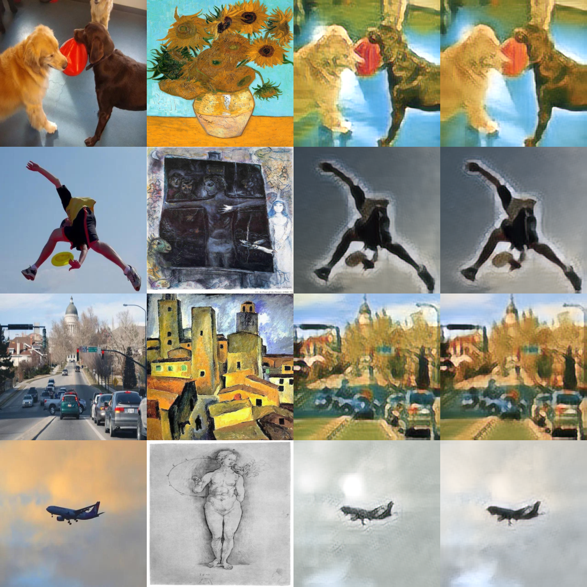

# Experiment B — Content weight 10

This experiment increases the content loss coefficient from 7 to 10.
The style and identity coefficients remain 10, 70 and 1. Both runs use
5,000 updates, batch size 2, 256-pixel crops and a fixed Adam learning rate
of 0.00005. The local loss is disabled.

## Reproduce

From the repository root, in the configured stytr2 environment:

    python train_baseline.py --crop256 --steps 5000 --content-weight 10 --output step2_content10
    python evaluate_full_grid.py --models A B --output evaluation_full_grid_ab

Training takes approximately 24 minutes on our RTX 5060 Laptop GPU.
The evaluator expects baseline weights in step1_256_5000/stytr2.pth
and B weights in step2_content10/stytr2.pth. Use a fresh training output
folder if preserving a previous run, then adjust the evaluator paths.
Images and the frozen VGG weights must be prepared as described in the root README.

## Recorded results

Each split evaluates 32 content photographs × 12 reference paintings = 384 pairs.
Validation and test use separate image sets.

| Split | Metric | Baseline A | B | Change |
|---|---|---:|---:|---:|
| Validation | Content loss | 2.08947 | 1.99254 | -4.64% |
| Validation | Style loss | 3.26434 | 3.38009 | +3.55% |
| Test | Content loss | 2.26005 | 2.16901 | -4.03% |
| Test | Style loss | 2.39687 | 2.22962 | -6.98% |

Lower losses indicate closer feature agreement. Content loss decreased on both
splits, while style loss changed in opposite directions. Each setting was trained
once. Some model layers were initialized before seeding, so A and B did not have
identical starting weights. These results cannot isolate the coefficient effect
from initialization variation.

## Visual examples

Columns show content, reference artwork, baseline A and experiment B.
These four examples illustrate the measured comparison and do not represent
all 384 pairs.

The aircraft has a more continuous silhouette in B, but its speckled texture is
less pronounced. Clothing detail remains limited in the athlete example.

summary.json, pairs.csv and by_style.csv contain the full-grid evaluation.
train.csv records this B training run. Local loss is a supplementary metric
computed at evaluation time; it was not used to train A or B.
